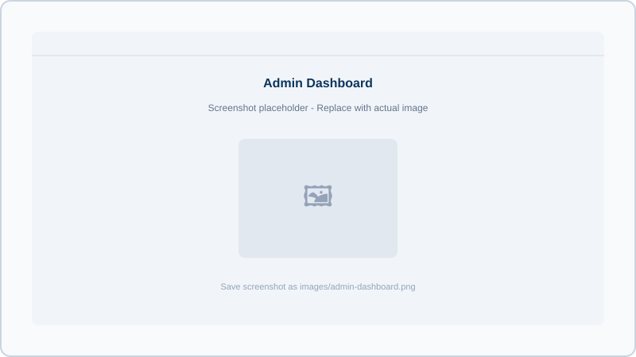

# Admin Dashboard (`/admin/dashboard`)

## File

`frontend/src/pages/admin/AdminDashboard.jsx`

## What it shows

- **Stat cards** — admins, pending / approved / rejected / expired / total members, your role
- **Charts** (Recharts) — member logins + admin logins (last 30 days) and membership status distribution
- **Leadership board** — full-width student officers carousel
- **GCash settings** editor at the bottom (President/Treasurer or full-control)

Role management and officer creation are handled in the **Admins** page, not here.

## How to move around

| Action | Result |
|---|---|
| Manage members | Links to `/admin/membership` (not shown for RESTRICTED) |
| Verify a pending member | Opens `/admin/membership/:id/verify` |
| Edit GCash settings | `PATCH /api/members/payment-settings/` |

## Permission gating

| Capability | Who |
|---|---|
| `canManageRoles` | GCash settings editing |
| `canApproveMembers` | PRESIDENT / SECRETARY |
| `RESTRICTED` access | Member stat cards, member-login chart and membership-status chart are hidden; GCash settings are read-only |
| President-only positions | `PRESIDENT`, `TREASURER`, `SECRETARY`, `NONE` |

## Key API calls

| Endpoint | Use |
|---|---|
| `GET /api/audit-logs/stats/` (via sidebar) | Unread logs badge |
| `GET /api/members/stats/` | Member counts and login activity (skipped for RESTRICTED) |
| `GET /api/users/admin-login-stats/` | Admin login activity |
| `GET/PATCH /api/members/payment-settings/` | GCash settings |

## Notes

- Dispatches window events (`officers-refresh`, `member-list-updated`, `payment-settings-updated`) so all open pages update.
- Uses `OfficersProvider` for the leadership carousel.

## Preview

## Related Pages

- [Screen: Admin Membership](/screens/admin-membership)
- [Screen: Admin Admins](/screens/admin-admins)
- [Flow: Payments & E-Receipts](/flows/payments-receipts)
- [Admin Guide: Dashboard](/admin-guide/dashboard)
