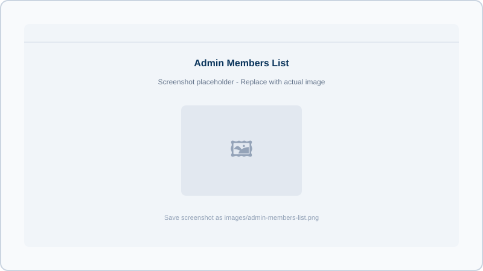
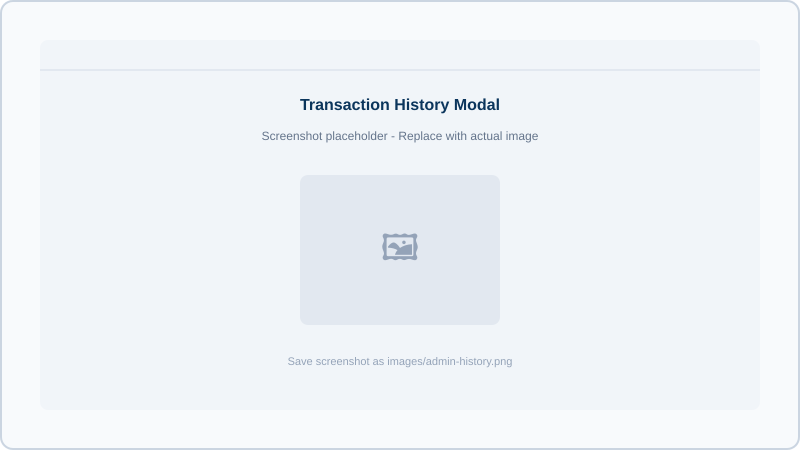

# Admin Membership (`/admin/membership`)

## File

`frontend/src/pages/admin/placeholder/AdminMembership.jsx`

## What it shows

The member management table:

- **Search** by name/student number
- **Status filter** (ALL / PENDING / APPROVED / REJECTED / EXPIRED)
- **Year filter**
- **Pagination** (10 / page)
- Expandable member rows
- **Edit / delete / history / add-member** modals

## How to move around

| Action | Result |
|---|---|
| Expand a row | Shows details + actions |
| **Verify** a member | Opens `/admin/membership/:id/verify` |
| Add member | Opens the add-member modal (creates account with temp password) |
| Edit member | Opens edit modal → `PUT/PATCH /api/members/<pk>/` |
| Delete member | Confirm → `DELETE /api/members/<pk>/` |
| View history | Shows transaction history modal |

## Permission gating

Only **FULL_CONTROL** and **MEMBERSHIP** admins can view member data. `RESTRICTED` admins cannot
open this page (the sidebar link is hidden and the route redirects to the dashboard), and the API
returns an empty member list / `403` on member detail. Inside the page, `isRestricted` admins are
also blocked from destructive actions.

## Key API calls

| Endpoint | Use |
|---|---|
| `GET /api/members/` | List (admin sees all) |
| `POST /api/members/` | Add member (creates temp password) |
| `PUT`/`PATCH`/`DELETE /api/members/<pk>/` | Edit / delete |
| `GET /api/members/transactions/` | History |

## Preview

## Related Pages

- [Screen: Admin Membership Verify](/screens/admin-membership-verify)
- [Flow: Member Approval & E-Receipt](/flows/member-approval-receipt)
- [Admin Guide: Membership](/admin-guide/membership)
