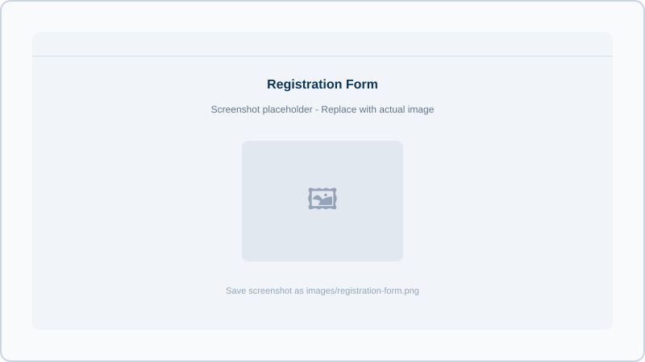

# Register (`/register`)

## File

`frontend/src/pages/auth/Register.jsx`

## What it shows

The multi-part membership application form:

1. **Payment** — payment method, membership plan, GCash details, proof of payment
2. **Account info** — email, username, password, confirm password (with live availability checks)
3. **Personal info** — first/middle/last name, sex
4. **Student info** — student number, course, year level (1–4), section, contact number
5. **Documents + agreement** — profile picture, COE/ID (JPG/PNG/PDF, ≤ 10 MB), and the "I agree to the Privacy Policy" checkbox at the very end

## How to move around

| Step | Instruction |
|---|---|
| 1 | Choose a payment method / membership plan and upload proof of payment |
| 2 | Fill account info (email/username availability, password ≥ 8 chars) |
| 3 | Fill personal info including sex |
| 4 | Fill student info (student number format `XXXX-XXXXX`, contact `09...`) |
| 5 | Upload profile picture and COE/ID (each ≤ 10 MB), then agree to the Privacy Policy |
| Submit | `POST /api/auth/register/`, redirect to `/membership-pending` |

## Key API calls

| Endpoint | Use |
|---|---|
| `POST /api/auth/register/` | Create user + member profile |
| `GET /api/auth/availability/` | Pre-check email/username |

## Notes

- Registration creates a **PENDING** member (see [Registration flow](/flows/member-registration)).
- JWT tokens are returned on success so the member can log in immediately.
- On rejection the form surfaces field-level errors (toast).

## Preview

## Related Pages

- [Flow: Member Registration](/flows/member-registration)
- [Screen: Membership Pending](/screens/membership-pending)
- [User Guide: Members](/user-guide/members)
